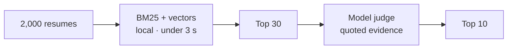

<div align="center">

<picture>
  <source media="(prefers-color-scheme: dark)" srcset="assets/brand/hero-dark.svg">
  
</picture>

<br>


<br>


**[Quick start](#quick-start)** &nbsp;·&nbsp; **[What's inside](#whats-inside)** &nbsp;·&nbsp; **[Under the hood](#under-the-hood)** &nbsp;·&nbsp; **[Roadmap](#roadmap)** &nbsp;·&nbsp; **[Full spec](docs/spec.md)**

</div>

**Drop in 2,000 resumes. Paste a job description. Read ten candidates — each with a score you can defend and evidence you can read.**

| **2,000+** | **< 3 s** | **33 MB** | **0** |
|:--:|:--:|:--:|:--:|
| resumes per library | local first pass | embedding encoder | webviews |

> [!NOTE]
> **Early build.** Import, search, local embeddings, and grounded chat run on macOS today. JD → Top 10 is next.

## Three steps

| **01 · Drop in** | **02 · Paste the job** | **03 · Read ten** |
|:--:|:--:|:--:|
| PDF, DOCX, TXT.<br>One file or a whole folder. | Job description in.<br>Editable, weighted criteria out. | Ten names, ranked.<br>A score, evidence, and gaps. |

## What's inside

| Surface | What it does | |
|:--|:--|:--:|
| **Import** | Drop a folder. Every resume is searchable in about a second. | ✅ |
| **Candidates** | Searchable table, candidate drawer, rich notes, dark mode. | ✅ |
| **Chat** | Ask the library. Answers cite candidates as inline chips. | ✅ |
| **Job** | A JD becomes visible, editable, weighted criteria. | 🚧 |
| **Top 10** | Ten candidates, scored and explained. | 🚧 |
| **Report** | CSV or a clean PDF for the client. | 🚧 |

## Quick start

```bash
./scripts/fetch-model.sh            # once · 33 MB encoder
./scripts/run.sh                    # build + open
SHORTLIST_DEMO=1 ./scripts/run.sh   # demo library
```

Rust stable · macOS 13+ · [OpenCode](https://opencode.ai) for AI features.

## Under the hood



Stage 1 is local and cheap. Stage 2 reads only thirty candidates — that is why a run takes a minute, not hours. [How it works →](docs/spec.md#6-how-the-ai-works)

## Why local

| | Cloud screening | **Shortlist** |
|:--|:--|:--|
| Candidate data | Uploaded to a vendor | **Stays on your disk** |
| The score | An opaque number | **Quoted evidence and gaps** |
| The model | Their choice | **Your existing OpenCode** |
| Offline | No | **Yes, except judging** |

## Roadmap

| ✅ Working today | 🟡 In progress | ⬜ Next |
|:--|:--|:--|
| Import + parsing | Virtualized table | JD → Top 10 |
| Local embeddings | Windows + Linux | Accuracy harness |
| Hybrid search | | PDF viewer |
| Grounded chat | | Packaging |
| Candidate drawer | | |
| Rich-text notes | | |
| Dark mode | | |

<div align="center">

**[Read the full spec →](docs/spec.md)**

<sub>Shortlist · Apache-2.0 · Rust + GPUI</sub>

</div>
