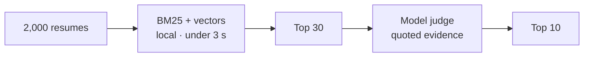

<div align="center">

<picture>
  <source media="(prefers-color-scheme: dark)" srcset="assets/brand/hero-dark.svg">
  
</picture>

<br>


**[Quick start](#quick-start)** &nbsp;·&nbsp; **[Features](#features)** &nbsp;·&nbsp; **[How it works](#how-it-works)** &nbsp;·&nbsp; **[Why local](#why-local)** &nbsp;·&nbsp; **[Status](#status)** &nbsp;·&nbsp; **[Spec](docs/spec.md)**

</div>

<p align="center">
  <b>Drop in 2,000 resumes. Paste a job description.<br>Read ten candidates — each with a score you can defend.</b><br>
  <sub>Native GPU app · local embeddings · no cloud account · no webview</sub>
</p>

| **2,000+** | **< 3 s** | **33 MB** | **0** |
|:--:|:--:|:--:|:--:|
| resumes per library | local first pass | embedding model | webviews |

> [!NOTE]
> **Early build.** The macOS app is usable today: import, search, embeddings, grounded chat, and local tools. JD → Top 10 is next.

## How it works

| **01 · Drop in** | **02 · Paste the job** | **03 · Read ten** |
|:--:|:--:|:--:|
| PDF, DOCX, TXT.<br><sub>One file or a whole folder.</sub> | A job description.<br><sub>Editable, weighted criteria out.</sub> | Ten names, ranked.<br><sub>Score, evidence, and gaps.</sub> |



Stage 1 is local and cheap. Stage 2 reads thirty candidates, not two thousand — a run takes a minute, not hours. [How the AI works →](docs/spec.md#6-how-the-ai-works)

## Features

| **Import** | **Hybrid search** | **Grounded chat** |
|:--|:--|:--|
| Drop a folder. Searchable in about a second. | BM25 + local vectors, fused with RRF. | Ask the library. Answers cite candidates inline. |

| **Structured ranking** | **Local tools + MCP** | **Self-updating** |
|:--|:--|:--|
| Roles, seniority, recency — not just skill overlap. | Eight compact tools in chat, CLI, and OpenCode. | Download, verify, install, reopen. |

Counts and lookups run locally; **tool payloads are 80–93% smaller** than the resume text they replace. The same eight tools — `stats` `find` `shortlist` `get` `read` `grep` `note` `compare` — support native tool calling via `shortlist-cli mcp install`. [Harness →](docs/harness.md)

## Why local

| | Cloud screening | **Shortlist** |
|:--|:--|:--|
| Candidate data | Uploaded to a vendor | **Stored on your disk** |
| The score | An opaque number | **Quoted evidence and gaps** |
| The model | Their choice | **Your OpenCode** |
| Offline | No | **Import, search, notes**<br><sub>Chat needs the model</sub> |

## Quick start

```bash
./scripts/fetch-model.sh            # once · 33 MB encoder
./scripts/run.sh                    # build + open
SHORTLIST_DEMO=1 ./scripts/run.sh   # demo library
```

Rust stable · macOS 13+ · [OpenCode](https://opencode.ai) for AI features.
Installed builds update themselves from [GitHub Releases](docs/updates.md).

<details>
<summary><b>Package & release</b></summary>

```bash
./scripts/package-macos.sh              # Shortlist.app + zip
./scripts/package-linux.sh              # portable Shortlist/ + zip
pwsh -File scripts/package-windows.ps1  # portable Shortlist/ + zip
./scripts/release.sh patch --push       # tag + publish
```

</details>

## Status

| ✅ Shipping | 🚧 Next |
|:--|:--|
| Import, parsing, hybrid search | JD → Top 10 |
| Candidate library, notes, dark mode | Accuracy harness |
| Grounded chat + eight local tools | PDF viewer |
| Structured ranking | CSV / PDF report |
| Packaging + auto-update | Windows + Linux hardening |

<div align="center">

**[Read the full spec →](docs/spec.md)** &nbsp;·&nbsp; **[Tool harness →](docs/harness.md)** &nbsp;·&nbsp; **[Updates →](docs/updates.md)**

<sub>Shortlist · Apache-2.0 · Rust + GPUI</sub>

</div>
