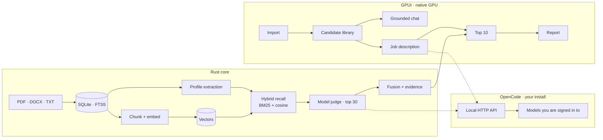

# Shortlist — product & engineering spec

[← Back to the README](../README.md)

The README is the tour. This is the blueprint: scope, architecture, AI design, accuracy targets, and the decisions behind them.

---

## 1. The problem

A recruiter receives hundreds to thousands of resumes per role. Reading them is slow, inconsistent, and impossible to compare fairly. Cloud AI tools solve the reading problem by creating a new one: candidate PII goes to a third party, results are non-deterministic, and nobody can explain why candidate #7 beat candidate #8.

Shortlist takes the opposite position. The library, the embeddings, the scores, and the notes live on the recruiter's disk. The model that writes a judgment is the OpenCode install already on the machine — and it only ever sees redacted text.

| | Reading by hand | Cloud screening | **Shortlist** |
|:--|:--|:--|:--|
| **2,000 resumes** | Weeks of evenings | Minutes | Minutes |
| **Candidate data** | Stays in the office | Uploaded to a vendor | **Stays on your disk** |
| **The explanation** | Memory | An opaque score | **Quoted evidence and gaps** |
| **Repeatability** | Varies by mood | Varies by run | **Versioned, cached, re-runnable** |
| **Cost** | Recruiter hours | Subscription + tokens | **Your existing OpenCode install** |
| **Offline** | Yes | No | **Yes — except the judging call** |

## 2. Product principles

- **Local-first, explicit boundary.** Every resume, PDF, and score lives on disk. Only redacted text reaches the model you chose, and you see it happen.
- **Explainable or it doesn't ship.** Every score decomposes into criteria with evidence quotes.
- **Deterministic where it counts.** Same inputs, same ranking. The model is a judge, not a random number generator.
- **The recruiter decides.** The app ranks and explains; it never auto-rejects or auto-contacts.
- **Light by construction.** No webview, no chat model, no OCR engine. One 33 MB encoder, loaded on demand.
- **Small surface.** Seven surfaces, one primary action each.

## 3. Surfaces

1. **Import (live)** — drag in one resume or a bunch. Each becomes searchable immediately, with staged progress and a Stop control.
2. **Candidates (live)** — a fast, searchable library, with the original file preserved beside the extracted profile.
3. **Chat (live)** — ask the library a question. Answers are grounded in retrieved candidates and cite their names.
4. **Job (next)** — paste or write a JD. The AI turns it into criteria you can see, edit, and weight.
5. **Top 10 (next)** — exactly ten candidates, ordered, each with a score band, matched evidence, gaps, and a two-line rationale.
6. **Report (next)** — export the ten as CSV or a clean PDF for the client.
7. **Settings (live)** — four compact cards for OpenCode, semantic index, local data, and appearance; model selection opens in a searchable dialog.

Everything is one window, one accent colour, generous whitespace, keyboard-first. No dashboards, no charts that don't answer a question.

### Interaction details

- **Candidate drawer** — click any row and the candidate slides in from the right with contact details, skills, summary, and the extracted resume. Selecting another candidate updates the drawer in place: the panel keeps its width, the profile fades in, and the scroll resets.
- **Collapsible sidebar** — 220 ms width animation between 224 px and a 76 px icon rail. The choice is remembered.
- **Dark mode** — true-black background, near-black cards, matching GPUI Kit surfaces; toggle at the bottom of the sidebar.
- **Streaming chat** — assistant tokens arrive over SSE and render as markdown in a live bubble with a blinking cursor.
- **Chat rhythm** — avatar bubbles, a 24 px message gap, a three-dot thinking animation, and a floating composer with a circular send button.
- **Inline candidate chips** — a compact neutral pill with a soft initial avatar and a chevron; no citation strip at the bottom.
- **Candidates table** — avatars, skill chips, hover rows, a chevron into the drawer, and a confirmation before deleting a candidate and its indexed chunks. Every column except Skills is fixed; Skills absorbs the remaining width and Actions stays pinned right.
- **Rich-text notes** — bold, italic, underline, strikethrough, seven text colours, five highlighter colours, and clear formatting. Stored per candidate as versioned JSON in SQLite, using the editor engine already shipped with GPUI Kit.
- **Import progress** — a banner with the current file, the active stage (extracting, reading with AI, embedding, saved), a segmented progress bar, and a Stop button that halts at the next safe point.

## 4. Architecture



Two rules keep it honest: **the core never imports the UI, and the UI never touches the database.** Retrieval and ranking can run headlessly, and GPUI stays a replaceable shell.

### Storage layout

```
macOS    ~/Library/Application Support/Shortlist/
Windows  %APPDATA%\Shortlist\
Linux    ~/.local/share/shortlist/

  db.sqlite          # metadata, profiles, scores, FTS5 index
  blobs/ab/cd/<sha256>.pdf
  logs/
  backups/
```

Originals are content-addressed by SHA-256: identical files are stored once, re-imports are free, and deleting a candidate never corrupts another record.

## 5. Stack

| Layer | Choice | Why |
|:--|:--|:--|
| Language | **Rust 2024**, stable | Single binary, no runtime, predictable memory |
| UI | **GPUI Kit 0.9.1** (GPUI 0.3.12) | GPU-rendered, no webview; inputs, buttons, accessibility, virtual lists |
| PDF text | `pdf-extract` now, `pdfium` later | Pure-Rust extraction today; pdfium for rendering and OCR |
| DOCX | `zip` + `quick-xml` | No Office dependency |
| Storage | **SQLite** via `rusqlite`, WAL, FTS5 | Portable single file; 2,000 rows is trivial |
| Retrieval | **FTS5 BM25 + `e5-small-v2`**, fused with RRF | Lexical precision plus semantic recall; no ANN index needed |
| Embeddings | `fastembed` + `intfloat/e5-small-v2` int8 | 384 dims, ~33 MB, MIT, CPU-only, 512-token context |
| AI | **OpenCode via its local API** | Reuses terminal auth; no keys in the app |
| Packaging | Planned: `cargo-packager` | dmg, msi, deb, AppImage from one config |

### Why GPUI

GPUI is the only mainstream Rust UI that is GPU-rendered, hybrid retained/immediate, and ships a list widget built for tens of thousands of rows. It gives Metal on macOS, Win32/DirectWrite on Windows, and Wayland/X11 on Linux — one codebase, no webview, no JavaScript runtime, materially lower memory than Tauri or Electron.

It is pre-1.0, so breaking changes between minor versions are expected. We pin an exact `gpui-kit`, keep every GPUI call inside `crates/app`, and run the three-OS build matrix so an upstream break is caught in hours, not weeks. Our own component set (button, input, table row, score band, sheet) is built on GPUI primitives; no heavy third-party UI dependency.

## 6. How the AI works

### 6.1 OpenCode is the only AI path

The app ships no LLM runtime and never stores an API key. It is another client of the OpenCode already installed and signed in in the terminal, the same way the TUI or T3 connects to it.

Non-streaming calls use `opencode api <method> <path>`. Streaming chat talks to the local HTTP API directly: the app reads the service URL from `opencode service status` and the Basic-auth password from `~/.config/opencode/service.json`, then subscribes to `/api/event` and consumes `session.text.delta` events as they arrive. The local password never leaves the machine.

| Purpose | Call |
|:--|:--|
| Check install | `opencode --version` |
| List models | `GET /api/model` |
| New chat | `POST /api/session` |
| Set model | `POST /api/session/{id}/model` |
| Send | `POST /api/session/{id}/prompt` |
| Stream | `GET /api/event` (SSE `session.text.delta`) |
| History | `GET /api/session/{id}/message` |
| Delete | `DELETE /api/session/{id}` |

If the binary is missing, a setup card explains the install; import and browsing still work.

**Model selection.** A picker in Settings and in the chat header lists every model OpenCode reports as active, with its provider and model id. The choice is stored locally and applied to the current and future sessions. Changing models never restarts the app, and there is no bundled model list to go stale.

### 6.2 Extraction: local text, AI-structured profile

```
PDF/DOCX → text (local) → AI profile call → validate + merge → chunk + embed
                                                    │
                                          AI fails? → deterministic fallback
```

Text extraction is local and deterministic. The selected model then receives the resume text and returns one strict JSON profile: name, headline, location, total experience, skills, summary, email, and phone. The result is validated before saving — a section heading can never become a name, and missing fields fall back to the rule-based profile. A bad name can be repaired from the drawer with **Re-read with AI**.

This is one call per resume, not per query. The model is involved only where it earns its keep:

- **Profile extraction** — one structured call per imported resume.
- **JD structuring** — one call per job, not per candidate.
- **Ranking the top 30** — the model reads the redacted resume text directly.
- **Re-read with AI** — repairs a profile without re-importing.

The only local model is the embedding encoder, which runs after extraction, on the machine, with no network. It is the one thing we bundle because it buys semantic recall that rules cannot.

### 6.3 Ranking: two stages

**Stage 1 — hybrid, over all 2,000+.** Under a second. Two independent retrievers run against every candidate:

- **Lexical:** field-weighted BM25 over the full resume text, must-have and nice-to-have term matching, and a skill-synonym map ("Rust" ↔ "systems programming", "JS" ↔ "JavaScript").
- **Semantic:** cosine similarity between the JD and each resume section, using local `e5-small-v2` embeddings.

Reciprocal rank fusion merges the two lists, and the structural scorers (years curve, seniority, recency, domain) adjust the result. Output: a 0–100 pre-score and the **top 30**. Nobody sees this list; it exists to hand the model a good pool.

**How the embeddings are built.** After text extraction, each resume is split into section-aware chunks (summary, each role, skills, education), roughly 300 tokens with 50-token overlap. E5 expects its prefixes — `passage: ` for resumes, `query: ` for the JD — and skipping them costs accuracy. The result is 384-dimensional vectors stored in SQLite next to their chunks.

**No ANN index.** 2,000 resumes × ~10 chunks is about 20,000 vectors, roughly 30 MB as f32. Brute-force cosine takes a few milliseconds. An HNSW index would add a dependency and a build step for no user-visible gain.

**Why two retrievers.** BM25 catches exact skills and titles; embeddings catch the candidate who wrote "built payment rails" when the JD says "fintech infrastructure". Either one alone misses the other's cases, and the top-30 pool is only as good as its recall.

**Stage 2 — model judge, top 30 only.** The model rates each rubric criterion 0–5 with a quoted justification at temperature 0. It reads thirty candidates, not two thousand — that is what makes a job take a minute instead of hours. The ten highest fused scores are the product; the other twenty are a buffer, so a weak first pass does not cost the right candidate a place.

**Fusion.** Weighted sum of stage-1 subscores and stage-2 rubric scores. Weights live in config, are visible as sliders, and are tuned against the golden set — never hardcoded to vibes.

**Caching.** Scores are keyed by `hash(jd_version, profile_version, model_id, prompt_version, rubric_version)`. Moving a weight slider re-runs only the arithmetic; the expensive judging is reused. Embeddings are keyed by `hash(content_hash, model_id, chunker_version)` — editing one resume re-embeds one resume, never the library.

**Incremental by design.** Adding a resume after a run does not re-score the library. The newcomer goes through stage 1, the shortlist is marked stale, and one click scores only the new candidates before re-fusing the top 10. This is the normal case, not an edge case.

**Why embed raw text, not LLM summaries?** Summarizing 2,000 resumes would cost 2,000 calls and bake hallucination into the index. Embedding the extracted text is faithful, free, and fast; the LLM adds judgment only on the top 30. If the golden set shows recall misses, widening K from 30 to 50 is a config change, not a redesign.

### 6.4 Fairness and safety

- Identity fields (name, gender, age, nationality, photo, marital status, address) are stripped before any model call. They are re-attached only for display.
- The prompt scores **evidence**, not impressions; "no evidence" is a valid, recorded answer.
- A local audit log records provider, model, prompt version, input hash, and output for every judgment.
- No rejection emails, no auto-actions. Human decision only.

### 6.5 Chat grounded in the library

The chat is not a generic assistant. Every question goes through the same hybrid retriever the ranker uses:

1. The question is embedded with the `query: ` prefix and scored against the local vectors.
2. BM25 scores the same library.
3. Reciprocal-rank fusion picks the four best candidates.
4. Their excerpts go into the prompt, with instructions to cite names and admit missing evidence.
5. The answer is stored in local history and shown in the thread.

Sessions are local rows mapped to OpenCode session ids. **New chat** creates both; **delete** removes both. The title becomes the first question.

Replies stream token-by-token from the SSE bus into a live assistant bubble. A small custom markdown renderer keeps headings and bullets, turns full candidate names into inline avatar chips, and shows a blinking cursor while tokens arrive.

## 7. Accuracy

### 7.1 Definition

Ground truth = the recruiter's own shortlist for a job. The app is right when it agrees with them, early and in roughly the right order.

| Metric | Target | Plain meaning |
|:--|:--:|:--|
| **Top-10 recall** | **≥ 0.95** | 9.5 of every 10 candidates they would shortlist appear in our top 10 |
| **NDCG@10** | ≥ 0.85 | The order is close, not just the membership |
| **Hard-requirement precision** | ≥ 0.98 | We rarely present an unqualified candidate as qualified |
| **Ranking stability** | 95% of the top 20 move ≤ 1 place | Same inputs, same answer |

### 7.2 How we earn it

1. **Golden dataset first.** 120 resumes × 5 real JDs. For each JD the recruiter marks their own top 10 and grades the rest 0–3 in a dedicated labelling screen. The set is frozen before any tuning.
2. **Measure before tuning.** No weight, prompt, or model change ships without a before/after report.
3. **Tune the fusion, not the model.** Most gains come from rubric design, weights, synonym coverage, and knockout rules.
4. **Two-pass on the borderline.** Candidates scoring 45–65 get a second, stricter judgment with different rubric framing. Disagreement routes them to manual review instead of a coin flip.
5. **Regression gate.** CI fails if any golden JD drops more than 2 points of NDCG@10 against the last release.

### 7.3 Honest caveat

No one can promise 95% on day one, and a demo on five hand-picked resumes proves nothing. What we can promise is a **measured** 90–95% on a real, recruiter-labelled set, with the number visible in the app's diagnostics — and a release that does not ship if the target is missed.

## 8. Handling 2,000+ candidates

The database is not the bottleneck. The chat model is — so we barely use it. Resumes arrive in dribs and drabs, never as one giant batch, and nothing waits for a batch job.

| Operation | Target | How |
|:--|:--|:--|
| Import one resume | < 1.5 s to searchable | Parse + chunk + embed inline; no LLM, no queue wait |
| Import a bunch of 50 | < 30 s | Parallel parse and embed, batched commit, live progress |
| Library of 2,000+ | Search in ms; rank in < 3 s | FTS5 + vectors indexed incrementally |
| Parse quality check | ≥ 95% usable text | Confidence score; failures land in "Needs review" |
| Embed 2,000 resumes | 30–90 s one-time | `e5-small-v2` int8, ~10 chunks each, rayon across cores |
| Stage-2 judging, top 30 | < 90 s first run, instant after | Parallel calls, cached per `(JD, candidate, model, prompt)` |
| Scroll the candidate table | 60 fps | GPUI `UniformList`, virtualized by row |
| Memory at 5,000 candidates | < 500 MB | Text in SQLite, PDFs on disk, pages in a 5-item LRU |

Ingest is a **durable queue, but a light one**: every file is a row, every step is idempotent, and killing the app mid-import loses nothing. Files arrive continuously, so there is no global re-index step — FTS5 updates as documents land. Duplicate detection runs on file hash first, then fuzzy identity (email, phone, name + overlapping roles).

### Resource targets

| Metric | Target |
|:--|:--|
| Idle RAM | < 150 MB |
| RAM with 2,000 candidates loaded | < 400 MB |
| Embedding model, loaded | +80 MB, unloaded after 5 min idle |
| Installer, all platforms | < 100 MB (includes the 33 MB model) |
| Cold start | < 800 ms |
| Idle CPU | ~0% |

## 9. Data model

```sql
files(id, sha256, path, mime, bytes, imported_at)
documents(id, file_id, kind, text, extractor_version, confidence)
candidates(id, name, email, phone, location, links_json, total_years,
           headline, merged_into, created_at)
candidate_documents(candidate_id, document_id, is_primary)
candidate_notes(candidate_id, body_json, updated_at)
profiles(id, candidate_id, document_id, json, confidence,
         extractor_version, created_at)
jobs(id, title, description, spec_json, weights_json, created_at, archived)
runs(id, job_id, stage, status, provider, model, started_at, finished_at)
scores(id, run_id, candidate_id, stage1, stage2, final,
       breakdown_json, evidence_json, cache_key)
eval_labels(id, job_id, candidate_id, grade, grader, created_at)
embeddings(id, owner_type, owner_id, chunk_index, model_id, dim,
           vector, content_hash, created_at)
```

The embeddings table holds one row per resume section — a few tens of megabytes at 2,000 resumes, so cosine runs in memory with no index server. `breakdown_json` and `evidence_json` are what make the UI explainable: the Top 10 view is a rendering of these rows, not a separate computation.

## 10. Repository layout

```
crates/
  app/       # GPUI window, screens, state, design system
  core/      # domain types, paths, chunking
  store/     # SQLite, FTS5, chat sessions, settings
  parse/     # PDF/DOCX/TXT, profile heuristics, isolated pdf helper
  embed/     # e5-small-v2, pooling, cosine
  ai/        # OpenCode transport, models, sessions, polling
  pipeline/  # hybrid retrieval, prompt construction, headless ask
  cli/       # seed, import, index, ask
assets/      # brand art; e5-small-v2 files (fetched by script)
scripts/     # fetch-model.sh, run.sh
```

The roadmap's `ingest`, `rank`, and `eval` crates are folded into `store` and `pipeline` for now; they split when the JD ranker and accuracy harness land.

## 11. Development

The workspace has three binaries: the desktop app (`shortlist`), the headless tool (`shortlist-cli`), and the isolated PDF helper (`shortlist-pdf`). `default-members` points plain `cargo run` at the app.

```bash
./scripts/fetch-model.sh      # once: downloads e5-small-v2 (~33 MB)
./scripts/run.sh              # builds the app + isolated PDF helper, then opens it
SHORTLIST_DEMO=1 ./scripts/run.sh   # with the demo library

cargo run                     # app only
cargo run -r                  # app only, release build
```

Use `./scripts/run.sh` when you need the PDF helper built too; it is what makes malformed PDFs safe.

The headless path is testable without the window:

```bash
cargo run -p shortlist-cli -- seed
cargo run -p shortlist-cli -- index
cargo run -p shortlist-cli -- ask "Who has the strongest Rust background?"
```

The `cli` crate runs the exact retrieval and answer path without a window, so retrieval and prompt changes are testable in CI.

## 12. Roadmap

One developer, with the recruiter available about two hours a week for labelling and feedback. Estimates are working weeks.

| Milestone | Week | Deliverable | Exit criteria |
|:--|:--|:--|:--|
| **M0 · Foundation + GPUI shell** | 1 | Cargo workspace, CI build matrix, migrations, logging, error model, pinned GPUI, first window. | Builds on all three in CI; 2,000 rows scroll at 60 fps; idle RAM < 150 MB |
| **M1 · Ingest + parse** | 2–3 | Drag-drop/folder import, hash dedupe, blob store, PDF/DOCX/TXT, pdfium, durable queue. | One resume searchable < 1.5 s; 50 in < 30 s; ≥ 95% usable text; kill-and-resume loses nothing |
| **M2 · Candidate library** | 4 | Virtualized table, FTS5 search, filters, detail view, inline correction, merge, grading mode. | 60 fps at 2,000 rows on all three OSes; edits persist; first golden labels captured |
| **M3 · Local embeddings** | 5–6 | `e5-small-v2` int8, section-aware chunking with E5 prefixes, vector storage, cosine, background backfill. | 2,000 resumes embedded < 90 s; cosine over 20k vectors < 10 ms; only changed files re-embed |
| **M4 · OpenCode + Top 10** | 7–8 | Discovery, model picker, privacy confirmation, JD editor, criteria + weights, hybrid stage 1, stage-2 judge, evidence. | Picker lists every authenticated model; stage 1 over 2,000 < 3 s; top 30 judged < 90 s; every score has evidence |
| **M5 · Accuracy harness** | 9 | Golden dataset, metrics report, tuning CLI, CI regression gate. | Targets in §7.1 met on 5 JDs × 120 resumes; report visible in-app |
| **M6 · Polish + packaging** | 10–11 | Full design pass, empty states, onboarding, settings, export, backup/restore, dmg/msi/deb/AppImage. | Recruiter completes a real shortlist unassisted; clean install on all three OSes |
| **M7 · Hardening** | 12 | 5,000-resume soak, profiling, crash recovery, migration test, Linux GPU matrix. | 8-hour soak stable; < 500 MB at 5k; no data loss on forced quit |
| **M8 · Private beta** | 13 | Ship to the agency, instrument locally, iterate. | Two weeks of daily use; accuracy holds on live JDs |

**Critical path:** M1 parsing quality → M3 embedding quality → M4 ranking quality → M5 measurement. If parsing or recall is bad, everything downstream is bad; the golden set keeps us honest.

## 13. v1 acceptance criteria

- [ ] Import one resume in under 1.5 s, or a bunch of 50 in under 30 s.
- [ ] Library scales to 2,000+ candidates without re-indexing existing files.
- [ ] Every resume is chunked and embedded locally; only changed files re-embed.
- [ ] Store the original file **and** the extracted profile for every candidate.
- [ ] Rank against a real JD and show the ten best in under 2 minutes, with a written reason for each placement.
- [ ] Top-10 recall ≥ 0.95 and NDCG@10 ≥ 0.85 on the recruiter-labelled golden set.
- [ ] Runs on macOS 13+, Windows 10/11 x64, and Ubuntu 22.04+ x64.
- [ ] No bundled chat model, no OCR engine, no webview; the only bundled model is the 33 MB encoder.
- [ ] Installer under 100 MB per OS; idle RAM < 150 MB; < 500 MB with 5,000 candidates.
- [ ] Every LLM call shows provider and model; identity fields stripped before sending.
- [ ] Clean install from one package per OS.
- [ ] Export a client-ready top 10 (CSV + PDF).

## 14. Risks

| Risk | Impact | Mitigation |
|:--|:--|:--|
| GPUI is pre-1.0 | Breaking upgrades | Pin exact version, isolate in `crates/app`, three-OS CI |
| GPUI Windows/Linux newer than macOS | Platform bugs late | Test all three from day one; Linux GPU matrix |
| CI runners may lack a GPU | GUI tests cannot run there | CI builds and unit-tests; 60 fps verified on real hardware |
| Embedding model adds weight and a native dependency | Installer and build complexity | 33 MB int8 model, ONNX Runtime bundled per OS |
| E5 small v2 is English-only | Poor recall on non-English resumes | English-only v1; multilingual is a model swap |
| Chunking or missing E5 prefixes | Silent recall loss | Section-aware chunks, prefixes, regression per chunker version |
| Scanned PDFs | No text to parse | Flag as "needs review"; OCR is v1.1 |
| Model latency or cost | Slow ranking | 30 calls max per job, parallel, cached, disclosed |
| Resumes sent to a cloud provider | Privacy exposure | Redaction, explicit confirmation, per-run disclosure, audit log |
| OpenCode missing or outdated | No AI features | Detect at launch, guided install; import still works |
| Duplicate candidates | Skewed shortlist | Hash dedupe + fuzzy identity merge with confirmation |

## 15. Decisions and assumptions

### Decisions locked in

| # | Decision | Consequence |
|:--:|:--|:--|
| 1 | **Three platforms** — macOS, Windows, Linux | CI matrix and packaging are first-class, not a port at the end |
| 2 | **GPUI only** | No egui/Tauri fallback; pin the dependency and isolate it |
| 3 | **OpenCode for chat, one local encoder for embeddings** | LLM is whatever the install is authenticated for; embeddings run on CPU |
| 4 | **Top 10 only** | Stage 2 judges 30; the other 20 are a hidden buffer |
| 5 | **Accuracy = top-10 agreement** | Measured on the recruiter's own shortlists; release gates on it |
| 6 | **`e5-small-v2` int8, bundled** | 384 dims, 33 MB, MIT, English; hybrid BM25 + vector retrieval |

### Assumptions

- OpenCode is installed and authenticated to at least one capable model.
- The model can return structured JSON reliably; we validate and retry.
- Resumes are mostly digital PDFs or DOCX; scans are flagged, not OCR'd in v1.
- Resumes are English; `e5-small-v2` is an English-only model.
- The machine has a working GPU — required by GPUI, not by the embedding model.

## 16. Out of scope for v1

Local chat model setup · OCR for scanned PDFs · multilingual embeddings · multi-user or cloud sync · ATS integrations (Greenhouse, Lever, Workable) · automated outreach or rejection · interview scheduling and scorecards · mobile app · fine-tuning a custom model.

These are v2 conversations, not v1 scope creep.
